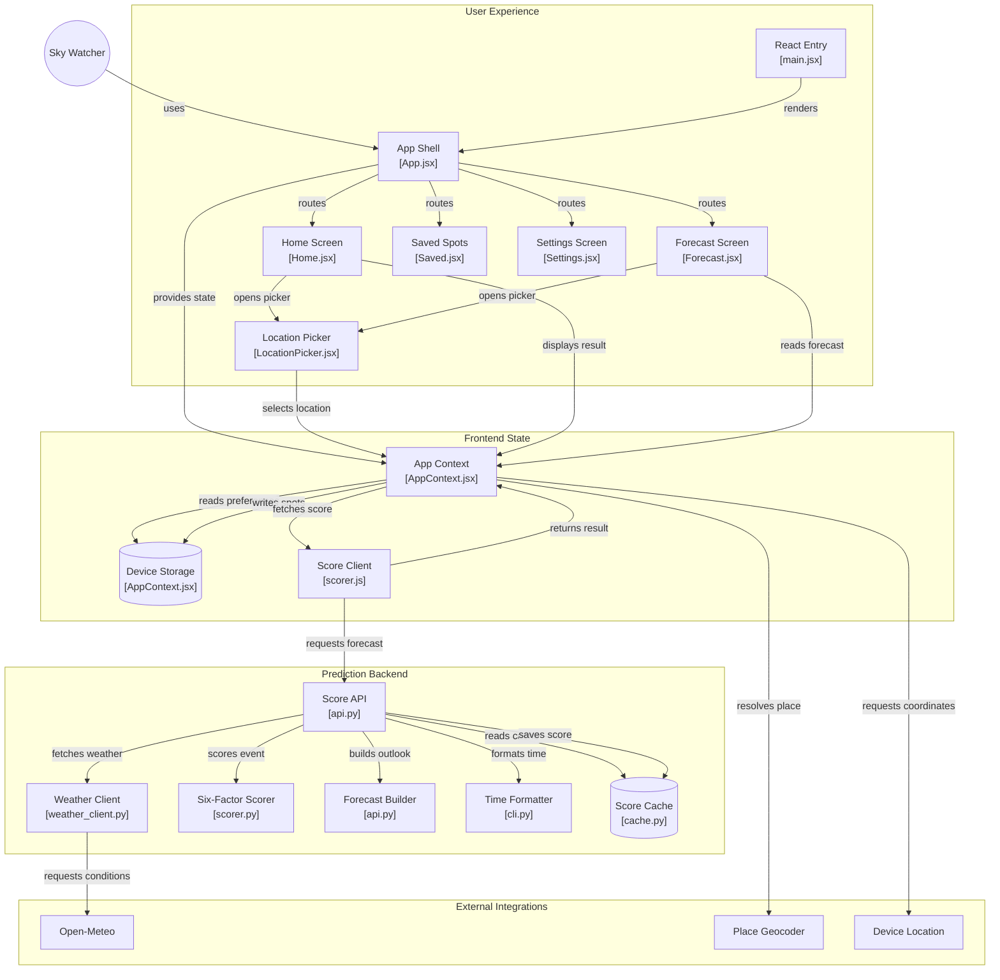

# Noki — Sunset & Sunrise Quality Prediction App

Noki is your personal sunset/sunrise quality predictor that tells you exactly how beautiful your next twilight moment will be. Whether you're planning a romantic evening walk, a photography session, or just want to know if today's sunset will be worth watching, Noki gives you the real answer: a simple 0-100 score with detailed explanations of why.

## Preview Images


kinda cool right? :3

## The Two Parts

There is the terminal part — the Python backend (`sunset_score/`) that runs in a terminal, takes weather data, and produces the score. That is the engine.

Then there is the actual app — the React frontend (`frontend/`) with CSS, UI design, mobile layout, and the interface people actually touch. That is what gets deployed. The terminal produces the prediction. The app makes it visible.

Both exist. They are separate. They work together.

## App Flowchart



## What Noki Actually Does

Noki takes several pieces of weather data that normally don't mean much on their own and puts them together into one prediction.

It looks at six factors:

- Total cloud cover
- Mid/high-level cloud structure
- Low cloud cover near the horizon
- Humidity
- Visibility
- Atmospheric timing and conditions

The point is not simply to produce a number.

If Noki gives you 85/100, you should be able to look at the result and understand why.

Maybe there is enough high cloud to catch the light.

Maybe the lower atmosphere is clear enough to leave the horizon visible.

Maybe visibility is excellent.

Or maybe the conditions are terrible and Noki tells you not to bother.

That's the idea.

## Features

- Real-time location
- Six-factor sunset/sunrise analysis
- 0–100 quality prediction
- Explanations behind the prediction
- Mobile-optimized interface
- No account required

## Project Structure

- `frontend/` - React app (CSS, UI, mobile layout)
- `src/` - Python backend (terminal tool, scoring engine)
- `tests/` - Test suite

## Quick Start

```bash
# Terminal backend
$env:PYTHONPATH="src"
uvicorn sunset_score.api:app --reload

# Frontend app
cd frontend
npm run dev
```

## Setup

1. Create and activate a virtual environment:

   On macOS/Linux:
   ```bash
   python -m venv venv
   source venv/bin/activate
   ```

   On Windows (PowerShell):
   ```bash
   python -m venv venv
   .\venv\Scripts\Activate.ps1
   ```

2. Install dependencies:
   ```bash
   pip install -r requirements.txt
   ```

3. Set pythonpath:
   ```bash
   export PYTHONPATH=src
   ```

## Run the API Server

```powershell
$env:PYTHONPATH="src"
uvicorn sunset_score.api:app --reload
```

Check that the server is running:

```bash
curl http://127.0.0.1:8000/health
```

Request a sunset score:

```bash
curl "http://127.0.0.1:8000/score?lat=37.7749&lon=-122.4194"
```

An invalid latitude returns a validation error:

```bash
curl "http://127.0.0.1:8000/score?lat=91&lon=-122.4194"
```

Score responses are cached locally for 60 minutes by rounded location. The
cache is stored in `sunset_score.db`, which is created automatically and is
safe to delete whenever you want to clear it.

## How to Run

Pass latitude and longitude as command-line arguments to the CLI module:

```bash
python -m sunset_score.cli 37.7749 -122.4194
```

Example Output:
```text
Sunset Quality Prediction
-------------------------
Sunset Time: 7:52 PM
Score: 85/100

Notes:
 - 50% total cloud cover is in the productive range
 - Good mid/high cloud canvas (60%) structure for color
 - Low cloud cover is light (10%), keeping the horizon clear
 - Optimal humidity (45%) for vibrant colors
 - Excellent visibility (20.0 km)
```

## How to Run Tests

Run `pytest` from the project root:

```bash
pytest
```
